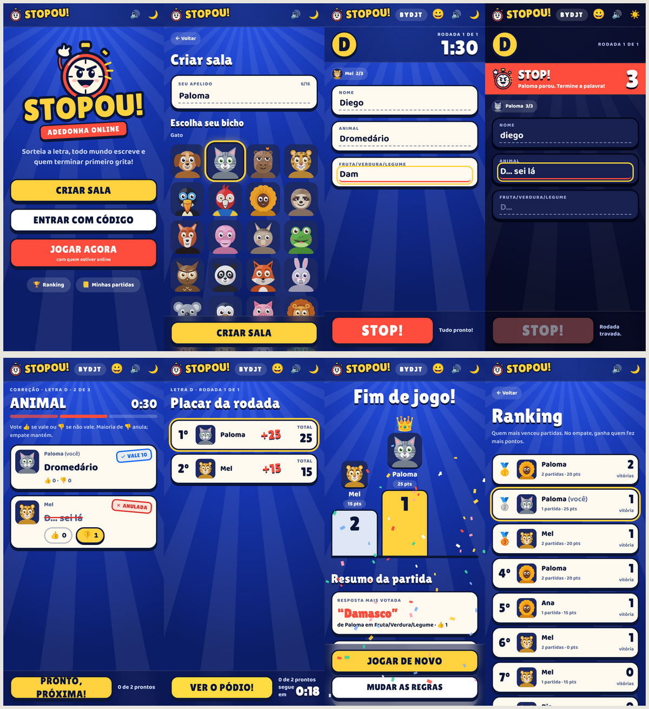

<h1 align="center">Stopou! ⏱️</h1>

  <b>A adedonha do caderno, agora no celular.</b> 
  Sorteia a letra, todo mundo escreve correndo e quem terminar primeiro grita <b>STOP!</b>

  <a href="https://jogostop-rabisco.vercel.app"><b>▶ JOGAR AGORA</b></a>

  

## Como jogar

1. **Crie uma sala** e mande o código (ou o QR code) para a galera.
2. **Escolha as categorias:** Nome, CEP, Animal, MSÉ… ou invente as suas.
3. **A letra é sorteada** e o relógio começa a correr.
4. **Preencheu tudo? Aperta STOP!** Os outros têm 3 segundos para terminar a palavra.
5. **Hora da correção:** cada um vota 👍 ou 👎 nas respostas dos outros.
6. **Resposta única vale 10, repetida vale 5.** Quem somar mais sobe no pódio. 🏆

  

## Por que é legal

- 📱 **De 2 a 10 pessoas**, cada uma no seu celular, em tempo real
- 🦫 **Sem cadastro:** escolha um apelido e um dos 84 personagens, nas coleções Divertidos, Tradicionais e Extras
- 🎲 **Jogar agora:** cai numa sala com quem estiver online
- 📦 **Pacotes prontos** de categorias (Clássico, Rapidinho, Cultura pop, Brasileirão…) e votação para **pular a letra**
- 🏆 **Folha da rodada** com a resposta de todo mundo e **pódio com suspense**, do 3º ao 1º
- 🔌 **Caiu a internet?** Você volta para o mesmo lugar, com as respostas salvas
- 📈 **Ranking, histórico** e dá para **instalar no celular** como app

## Feito com

React · TypeScript · Node.js · Socket.IO · Postgres · Tailwind CSS · Framer Motion

Como funciona por dentro, como rodar no seu computador e como publicar: <a href="docs/tecnico.md">docs/tecnico.md</a>
